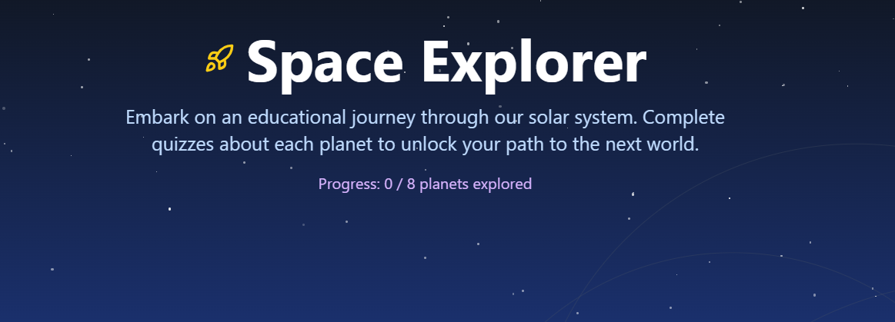

# 🌌 Space Exploration: Planetary Quiz Exploration Game 🚀

**Space Exploration** is an interactive web-based quiz game where players explore the solar system, landing on each planet and answering fun, educational quizzes to unlock the next. From **Mercury to Neptune**, it’s a journey of learning and discovery — one planet at a time!

## 👉 Play Now on: 

[SpaceXpo](https://spacexpogame.netlify.app/)

---

## 🌟 Features

- 🌍 **Planet-Based Exploration**  
  Start your space journey from Mercury and unlock all 8 planets.

- 🧠 **Fun and Informative Quizzes**  
  Each planet features two quiz questions based on real planetary science.

- 🔒 **Unlock Next Planet**  
  Answer both questions correctly to move forward in your journey.

- 📱 **Responsive Design**  
  Optimized for desktop, tablet, and mobile devices using Tailwind CSS.

- ⚛️ **React Router Navigation**  
  Seamless planet-to-planet transitions with clean route management.

- 💡 **Final Score Display**  
  Celebrate your cosmic achievement with a final score summary after Neptune.

---

## 🛠 Tech Stack

| Technology     | Role                       |
|----------------|----------------------------|
| **React**       | Frontend Framework         |
| **Vite**        | Lightning-fast bundler     |
| **Tailwind CSS**| Styling Framework          |
| **React Router**| Routing between planets    |
| **GH Pages**    | Deployment Platform        |

---

---
